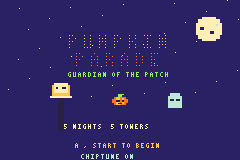
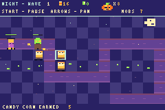

# Pumpkin Parade Guardian

 

Pumpkin Parade Guardian is a GBA homebrew tower defense. The ROM has a 240×160
screen, pixel-art towers and monsters, a scrolling 30×18 map, and original
Game Boy Advance PSG audio. The title screen plays a fast, gloomy harmonic
minor melody; gameplay uses responsive sound effects, including a low noise
shuffle as the cursor crosses the patch. A separate gloomy harmonic-minor
score plays during each night at a quicker note rate and stops when dawn
returns. A brief major-key cue celebrates each surviving wave. PSG routing is
initialized explicitly, and pulse/noise notes fade through their volume
envelopes instead of ending at an abrupt full-volume cutoff.

The GBA build uses a warm autumn palette for the build phase and a deep
purple-green palette at night. Its compact 3×5 pixel lettering has added
character spacing for readability, and the renderer uses paired pixel writes
to keep the screen and controls responsive on original GBA hardware. Game
state is placed in internal work RAM so it also initializes correctly when
an emulator skips the GBA BIOS.

## Build

Install the GNU Arm Embedded Toolchain, then run in PowerShell:

```powershell
.\build.ps1
```

The finished ROM is `build\pumpkin-parade.gba`. It can be opened in a GBA
emulator such as mGBA. This homebrew image leaves the BIOS boot-logo area blank,
so launch it with an emulator's skip-BIOS/fast-boot option; it will not boot
directly through the stock GBA BIOS on original hardware. In Webmulator, set
`mgba use bios` to `OFF` and `mgba skip bios` to `ON` before loading the ROM.
The linker keeps startup constants near the reset stub so BIOS-skipped
emulators can read them during early initialization.

## Controls

- D-pad: move the cursor and pan the map
- A (Z on Webmulator): plant the selected tower or buy its previewed upgrade
- B (X on Webmulator): sell the tower under the cursor
- Select (Shift on Webmulator): cycle tower types; over a tower, preview its
  evolution or next upgrade
- Start (Enter on Webmulator): begin the night or pause/resume the parade
- Title screen Left/Right: choose difficulty (Normal starts with 12 pumpkins;
  Hard starts with 8)
- Select previews only; it never changes tower stats or spends candy

The top build HUD previews the selected tower's purchase cost and
damage/speed/effect. Select previews a level-1 tower's evolution branch, or a
level-2 tower's level-3 upgrade, in the bottom HUD; it never changes the tower
or spends resources. Press A to buy the previewed level-2 evolution or upgrade.
The top HUD then shows the evolved tower name and live stats while the cursor
is over it. At night, moving over a tower briefly shows its name and stats in
the top HUD before the pan/pause hint returns. Moving to an empty tile during
the day returns the top HUD to the selected build tower. During the night,
moving the cursor over a monster briefly shows its name, current/maximum HP,
movement speed, and active slow/poison effects in the bottom HUD.
Level upgrades and evolution branches have distinct color markers.
Pausing the parade also silences its music; the night theme resumes when play
resumes. Nighttime sound effects use a separate noise channel so enemy defeat
and escape sounds cannot interrupt the music melody or bass. Upgraded towers
use branch-specific palette colors and small evolution-themed sprite details
instead of box outlines. Enemy health bars
appear after the enemy takes damage; their scaling is precomputed at spawn to
avoid per-frame division during combat. Night sky star positions are also
precomputed, and off-screen towers are skipped during drawing.

Defend the patch for ten nights. Candy corn pays for towers and upgrades;
moon seeds from surviving pumpkins pay for final upgrades. Lanterns and
cauldrons can harm ghosts, while physical towers cannot. Ghosts first appear
on Night 3, giving the player time to afford magic defenses. Towers fire visible
shots and enemies show their remaining health. Pumpkin Broods, Bramble Brutes,
Banshees, and Moon Moths join the parade from Nights 6-9; Broods split into two
seedlings when defeated. The Headless Horseman leads Night 10. The faster night
parade ends at dawn shortly after the final enemy is defeated or escapes.
The first night's zombies and trick-or-treaters have reduced health. The
bottom-right readout uses `D` for damage and `S` for attack speed, followed by
the effect (for example `D20/S2/SWAT`). Selecting an evolution branch shows
the evolved tower name, upgrade cost, and projected level-2 stats in the
bottom HUD. Moving the cursor away returns to the normal build prompt and
contextual cost/stats.

## Tower stats

Damage is per primary enemy hit; attack speed is approximate attacks per
second at normal game speed. Level 2 costs 60 candy and evolves the selected
branch. Level 3 costs 85 candy and 2 moon seeds and strengthens the evolved
tower. Branch selection previews the level-2 total stats, not an additive
bonus. Attack ranges are Manhattan-distance pixels and have been increased by
25%; Moonflower range is its aura radius in tiles.

| Tower | Cost | Level 1 | Level 2 evolution | Level 3 upgrade | Range L1/L2/L3 |
|---|---:|---|---|---|---:|
| Scarecrow Slinger | 50 | D9/S4/- | Crow Caller: D6/S7/flock | D8/S7/flock | 70/78/87 |
|  |  |  | Straw Sentinel: D24/S4/swat | D32/S4/swat | 70/27/36 |
| Jack-o'-Lantern | 75 | D20/S2/burn | Inferno Jack: D28/S2/splash | D36/S3/splash | 55/63/72 |
|  |  |  | Will-o'-Wisp: D42/S2/poison | D54/S3/poison | 55/63/72 |
| Witch's Cauldron | 65 | D5/S2/slow | Candy Glue: D7/S2/glue | D9/S2/glue | 61/70/78 |
|  |  |  | Hex Pot: D7/S2/hex | D9/S2/hex | 61/70/78 |
| Moonflower | 80 | D0/S0/buff | Blood Moon: D0/S0/fear | D0/S0/fear | 5/6/7 tiles |
|  |  |  | Star Bloom: D0/S0/buff | D0/S0/buff | 5/6/7 tiles |
| Bat Roost | 90 | D7/S6/swarm | Night Swarm: D9/S6/swarm | D12/S8/swarm | 85/93/102 |
|  |  |  | Vampire Bats: D18/S6/power | D24/S8/power | 85/93/102 |
| Thorn Maze | 125 | D14/S1/pierce+root | Briar Crown: D19/S2/pierce+root | D25/S3/pierce+root | 77/86/95 |
|  |  |  | Rose Sentinel: D23/S2/pierce+root | D30/S3/pierce+root | 77/101/110 |
| Grave Bell | 145 | D12/S1/pulse | Tollkeeper: D17/S2/pulse | D22/S2/pulse | 67/88/97 |
|  |  |  | Soul Choir: D21/S2/pulse | D27/S3/pulse | 67/76/84 |
| Star Compass | 170 | D30/S1/chain | Comet Seeker: D38/S1/chain | D49/S1/chain | 95/103/112 |
|  |  |  | Orrery: D42/S1/chain | D55/S2/chain | 95/121/130 |

Crow Caller attacks a group with half damage per enemy; Straw Sentinel deals
more damage at a short range. Inferno Jack splashes half damage onto nearby
enemies and poisons them; Will-o'-Wisp poisons its target. The Cauldron's slow
cuts movement speed by 75% for about one second; Candy Glue cuts it by about
83% for about two seconds. Hex Pot spreads poison. Blood Moon slows nearby
enemies and Star Bloom strengthens nearby tower cooldown buffs. Night Swarm
deals half damage to nearby enemies; Vampire Bats double their primary damage.
Evolved towers use larger, branch-colored projectiles. Crow Caller and Straw
Sentinel also have distinct silhouettes and colors, and their combat stats
match the HUD preview.

Evolved towers use larger, branch-colored projectiles. Crow Caller and Straw
Sentinel also have distinct silhouettes and colors. Their damage, range, and
attack speed are calculated separately, so the preview matches combat.

Late-game towers have higher purchase costs; they use the same level-up costs
and evolution selection as the other towers.

Thorn Maze damages nearby monsters and roots them; Briar Crown specializes in
rooting enemy groups, while Rose Sentinel trades control for greater damage and
range. Grave Bell damages and slows nearby monsters; Tollkeeper projects a
wider slowing pulse, while Soul Choir delivers stronger, faster pulses. Star
Compass chains damage to up to two nearby enemies; Comet Seeker fires chain
bolts more rapidly, while Orrery extends the reach of its chain attacks.

## Monster stats

HP is the value on the first night that monster appears. HP increases by the
listed amount per night through Night 4; from Night 5 onward, each night's HP
increase is 25% larger (rounded down). Pumpkin Brood and Seedling HP use the
same scaling. Speed is an internal movement value (higher is faster). Candy is
the kill reward. Hard mode adds three monsters to each wave and increases
zombie, werewolf, and Horseman HP by 20%; other enemy stats are unchanged.

| Monster | Appears | HP | Speed | Candy | Notes |
|---|---:|---:|---:|---:|---|
| Zombie | Night 1 | 38 (+8/night) | 130 | 11 | Slow and sturdy |
| Trick-or-treater | Night 1 | 16 (+4/night) | 300 | 5 | Fast, fragile swarm |
| Skeleton | Night 2 | 36 (+6/night) | 285 | 8 | Fast, reduced early HP |
| Ghost | Night 3 | 59 (+9/night) | 220 | 9 | Only magic towers can hurt it |
| Werewolf | Night 3 | 149 (+18/night) | 175 | 17 | Tough |
| Pumpkin Brood | Night 6 | 284 | 170 | 18 | Splits into two 86-HP seedlings on defeat |
| Seedling | On Brood defeat | 86 | 310 | 3 | Two per Brood; HP scales with wave |
| Bramble Brute | Night 7 | 340 | 140 | 25 | Heavy, slow bruiser |
| Banshee | Night 8 | 185 | 230 | 18 | Only magic towers can hurt it |
| Moon Moth | Night 9 | 164 | 355 | 14 | Very fast flyer |
| Headless Horseman | Night 10 | 1300 | 135 | 75 | Final boss; 1560 HP in Hard |
